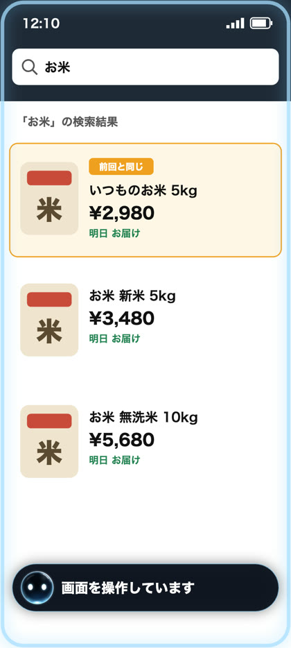
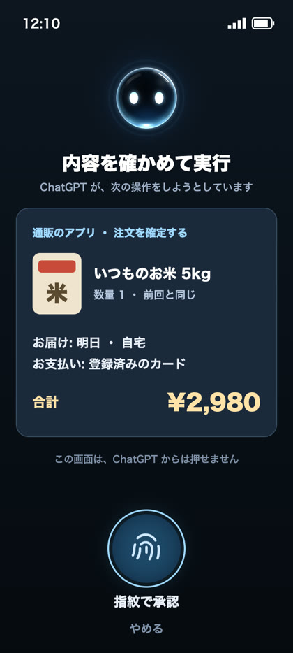
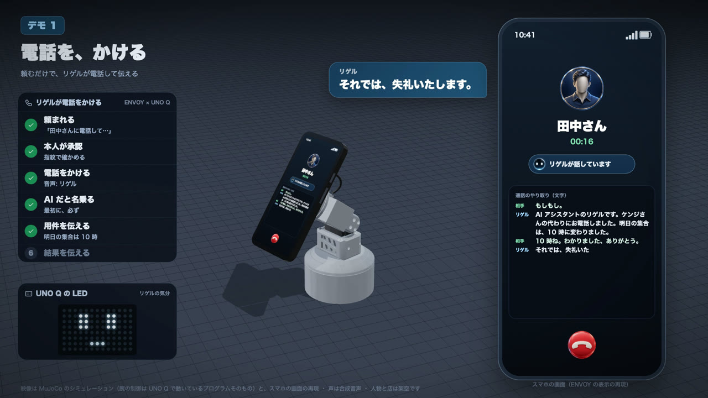
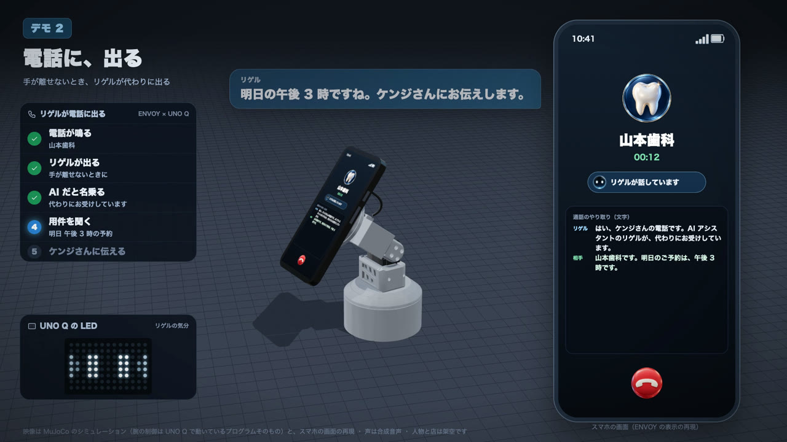
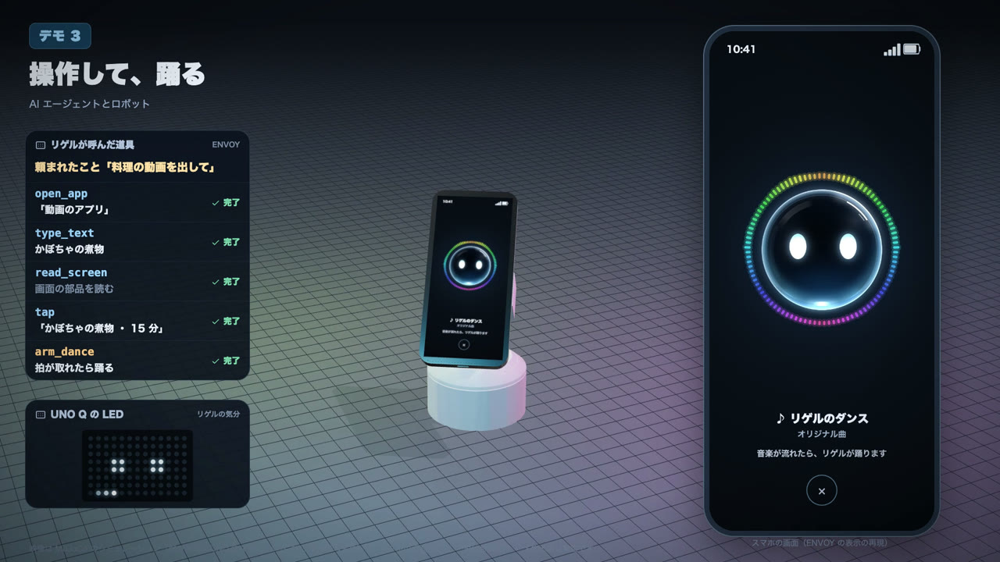
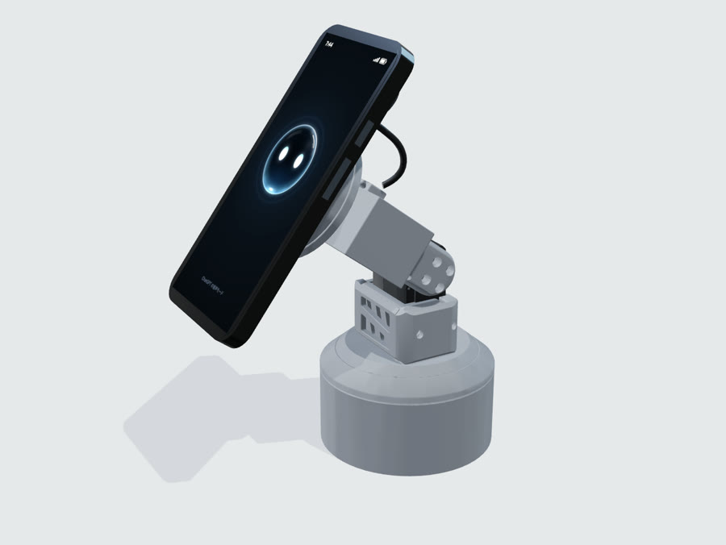
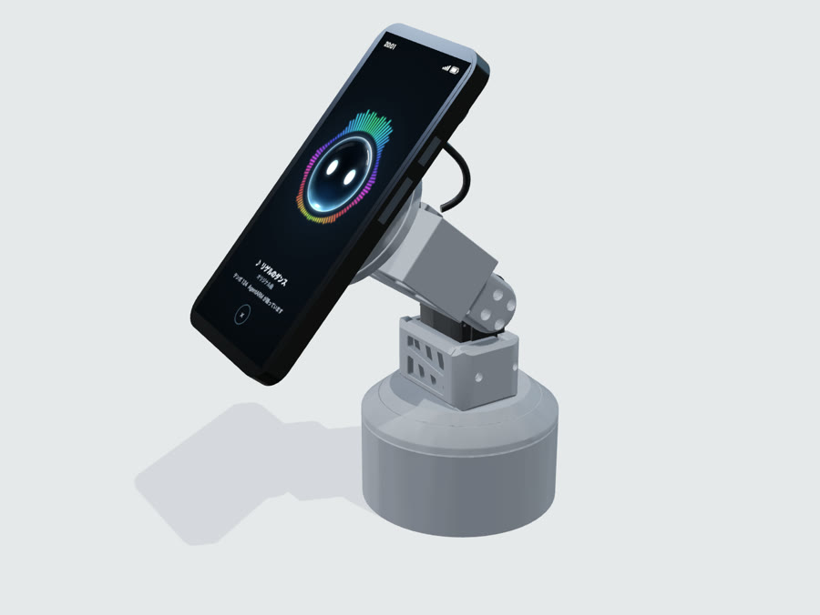

# ENVOY MCP


**話しかけるだけで、AI がスマホを操作する Android アプリ。**

ENVOY MCP は、スマホを操作する道具を **MCP（Model Context Protocol）** で出すサーバーです。MCP に対応した AI エージェントなら、どれでもつないで使えます。AI エージェントが考えて会話し、ENVOY MCP がスマホの上で手を動かします（アプリを開く・画面を読む・押す・入力する・電話をかける、など）。

このリポジトリでは、一例として **ChatGPT のアプリ（音声モード）と ENVOY MCP をつないでいます**。ChatGPT に声で頼むと、ChatGPT が ENVOY MCP の道具を使ってスマホを操作します。

ホーム画面には、ガラスの球のアバター「**リゲル**」だけがいます。リゲルをタップすると、ChatGPT の音声モードが開きます。

| 1. 話しかける | 2. AI がスマホを操作する | 3. 確定の前に、本人が確かめる |
| :---: | :---: | :---: |
|  |  |  |
| 音声モードの間は、画面いっぱいにリゲル | 操作の間は小さなリゲル（タップで止まる） | 内容を見せて、指紋で承認 |

## できること

| まとまり | 中身 |
| --- | --- |
| スマホの操作 | アプリやショートカットを開く・画面を読む・押す・文字を入れる・動かす・戻る・ホームに戻る。画面の画像を読んで、押せるものを見つける |
| 手順を覚える | うまくいった操作の手順を「部品」として覚え、次からはすぐに実行する |
| 写真 | 写真を言葉で探して（端末の中の EmbeddingGemma 2）、画面に並べて見せる・大きく見せる・アプリで共有する |
| 電話 | 電話をかける。**リゲルが代わりに電話をかけて用件を伝える**・**かかってきた電話に代わりに出る**（AgentARM のボードと組む）。代行中のやり取りを画面に文字で出し、通話の記録と録音を残す |
| 音声モード（ChatGPT と組むとき） | 開いたときに、最初の一言を自動で送る。「ばいばい」で音声モードを終える。音声モードの間は、画面いっぱいにリゲルを出す |
| お知らせ | 定期の依頼の結果（ChatGPT のスケジュール済みタスクが `rigel_notify` で預けたもの）と、電話のあとにまだ伝えていないこと（リゲルが出た・かけた電話の結果、だれも出なかった着信）を残し、小さなリゲルにベルを付ける。リゲルを押すと、音声モードの最初に伝える |
| リゲルの表情 | 会話に合わせて、リゲルがうれしい・驚く・照れるなどの表情を見せる |
| AgentARM（スマホを載せる腕） | 縦・横に向ける、利用者の方を向く・追う、追いながら撮る、音楽に合わせて踊る、表情に合わせて動く、止める |
| 音楽 | 音楽が流れたら、リゲルの音楽の画面を出す（歌詞・スペクトラム） |
| モニター（PC モード） | スマホをモニターにつなぐと、モニターに全画面のリゲルを出し、モニター側でアプリを操作する |

| リゲルが代わりに電話をかける | かかってきた電話に代わりに出る |
| --- | --- |
|  |  |

| 頼まれたことを、道具を呼んでこなす（AgentARM と組んで踊る） |
| --- |
|  |

| AgentARM（スマホを載せる腕） | 音楽に合わせて踊る |
| :---: | :---: |
|  |  |

画像は再現です（腕はシミュレーション、スマホの画面は再現）。

## しくみ

```
 AI エージェント（例: ChatGPT のアプリの音声モード）
   │ MCP
   ▼
 ENVOY MCP の MCP サーバー（スマホの中。合言葉で守る）
   ├ 端末の操作（ユーザー補助、または ADB）
   ├ 写真の検索（端末の中のモデル）
   ├ AgentARM（BLE で腕のボードへ）
   └ 電話の代役（Wi-Fi でボードの電話の代役へ）
```

- 道具は MCP の決まりどおりに出しているので、AI エージェントを選びません。
- 端末の操作は、ユーザー補助（設定でオン）か、ADB（ワイヤレスデバッグで自分の端末につなぐ）を選べます。
- AgentARM の腕の制御と電話の代役（通話の相手と話す部分）は、腕のボードの上で動くプログラムが受け持ちます。ボードのプログラムは別のリポジトリです。腕と電話の代役を使わなければ、スマホだけで動きます。

## 安心のしくみ

- **取り消せない操作は、本人が確かめる**: 送信・発信など、取り消せない操作の前には、内容を見せて指紋などで本人が承認します。承認は、その内容に結びついた 1 回限りのものです。
- **いつでも止められる**: 操作中に出る小さなリゲルをタップすると、今の操作を止め、しばらく道具を受け付けません。
- **電話の代役は AI だと名乗る**: リゲルは、電話の相手に最初に AI だと名乗ります。かける前には本人の承認が要ります。
- **個人の情報を記録に出さない**: 電話番号やメールアドレスは記録に出しません（電話番号は末尾 4 桁まで）。
- **画面の画像は設定しだい**: 画面の画像を AI に読ませるかは、設定で決めます。

## 道具の一覧

ENVOY MCP が AI エージェントに出す道具は、全部で 44 個です。送信・購入・発信など取り消せない操作は、道具が呼ばれても、スマホで本人が承認するまで実行しません。

### 様子・画面

| 道具 | すること |
| --- | --- |
| `get_state` | スマホの今の様子を返す（時刻・電池・画面の点灯とロック・前面のアプリ・ENVOY MCP の状態） |
| `read_screen` | 画面の部品（文字・ボタン・入力欄）を、番号つきで返す。`tap` と `type_text` は、この番号で部品を指す |
| `get_screenshot` | 画面の画像を返す（設定で切れる） |
| `look_at_screen` | 画面の画像を AI に読ませ、画面の説明と、押せそうなもの・入力欄を位置つきで返す（部品の一覧に出ないものも見つける） |
| `share_screenshot` | 画面の画像を写真に保存し、指定したアプリの共有に添えて開く |

### アプリ

| 道具 | すること |
| --- | --- |
| `list_apps` | 入っているアプリの一覧を返す |
| `list_shortcuts` | アプリのショートカット（アイコンの長押しで出る項目）の一覧を返す |
| `open_app` | アプリを開く |
| `open_shortcut` | ショートカットを開く（投稿の画面などをすぐ開く。送信・投稿はしない） |
| `open_panel` | クイック設定・通知を開く・閉じる |

### 操作

| 道具 | すること |
| --- | --- |
| `tap` | 部品を 1 回タップする（部品の番号・文字・`look_at_screen` の番号で指す）。送信・購入など取り消せないボタンは、本人が承認してから押す |
| `type_text` | 入力欄に文字を入れる |
| `scroll` | 上下左右にスクロールする |
| `back` | 戻るボタンを押す |
| `home` | ホーム画面に戻る |
| `press_key` | キーボードのキーを 1 つ押す |
| `wait` | アプリの読み込みなどを待つ（10 秒まで）。待ったあとの画面の様子を返す |

### 部品（覚えた手順）

| 道具 | すること |
| --- | --- |
| `list_parts` | 覚えた部品の一覧を返す |
| `run_part` | 部品を動かす。途中で画面が違えば止まる。確定のある部品は、本人の承認を待つ |
| `save_part` | この会話でした操作を、部品として覚える |
| `delete_part` | 覚えた部品を消す |

### 写真

| 道具 | すること |
| --- | --- |
| `search_photos` | 写真を言葉で探す（端末の中の EmbeddingGemma 2）。見つけた写真を、画面の下に番号つきで並べる |
| `show_photo` | 見つけた写真を、画面いっぱいに大きく見せる |
| `share_photo` | 見つけた写真を、指定したアプリの共有に添えて開く（送信はしない） |

### 電話

| 道具 | すること |
| --- | --- |
| `call_phone` | 電話をかける。連絡先から番号を探し、本人が承認したら発信する |
| `rigel_call` | リゲルが代わりに電話をかけ、AI だと名乗って用件を伝え、返事を聞いてくる（本人の承認が要る。腕のボードを使う） |
| `rigel_call_status` | `rigel_call` の電話の様子と結果（伝わったか・相手の返事の要点・やり取り）を返す |
| `rigel_call_hangup` | `rigel_call` の電話を、途中でやめて切る |
| `rigel_incoming` | かかってきた電話に、リゲルが代わりに出るか、本人が出るかを知らせる |

### 音声モード・表情・お知らせ

| 道具 | すること |
| --- | --- |
| `end_voice_chat` | 「ばいばい」などで、別れの挨拶のあとに音声モードを終えて閉じる |
| `rigel_expression` | リゲルに表情を一度見せる（うれしい・笑う・驚き・悲しい・照れ・ウインク） |
| `rigel_notify` | 伝えたいことをリゲルに預ける。小さなリゲルにベルが付き、押すと音声モードで伝える（定期の依頼の結果を届けるのに使う） |

### AgentARM（スマホを載せる腕）

| 道具 | すること |
| --- | --- |
| `arm_portrait` | スマホを縦に向ける |
| `arm_landscape` | スマホを横に向ける |
| `arm_look_at_me` | 前面カメラで利用者の顔を探し、画面を顔の方へ 1 回向ける |
| `arm_follow_me` | 利用者の顔を追い続ける |
| `arm_stop_following` | 顔を追うのをやめる |
| `arm_record_video` | 前面カメラで動画を撮りながら、顔を追い続ける |
| `arm_switch_camera` | 撮っている途中に、録画を止めずに前面・背面のカメラを切り替える |
| `arm_stop_recording` | 録画を止めて保存する |
| `arm_move` | 3 つの関節を角度で動かして、スマホの向きを変える |
| `arm_motion` | うなずく・首を振る・首をかしげるなど、決まった動きをする |
| `arm_dance` | スマホで流れている音楽の拍に合わせて踊る |
| `arm_stop` | 今の動きを止める |

## 必要なもの

- Android 12 以降（`minSdk 31`）。Pixel 10 で動きを確かめています
- MCP に対応した AI エージェント（例: ChatGPT のアプリ）
- 端末の操作に、ユーザー補助（または ADB のワイヤレスデバッグ）
- 腕と電話の代役を使うときは、AgentARM と腕のボード（別のリポジトリ）

## ビルド

```sh
export JAVA_HOME="/Applications/Android Studio.app/Contents/jbr/Contents/Home"
./gradlew :envoymcp:assembleDebug        # 作る
./gradlew :envoymcp:installDebug         # つないだ端末に入れる
./gradlew :envoymcp:testDebugUnitTest    # 単体の試験
```

## はじめの設定

1. ENVOY MCP をホームアプリに選ぶ（リゲルのタップで音声モードを開くため）
2. 設定の「MCP サーバー」をオンにする
3. 使う AI エージェントに、ENVOY MCP の MCP サーバーを登録する（例: ChatGPT のコネクター）
4. 設定の「ユーザー補助」を開き、ENVOY MCP をオンにする（または ADB を使う）
5. 腕を使うときは、設定の「AgentARM」をオンにして、腕のボードとつなぐ

## 同梱しているもの

- Google AI Edge Gallery の一部（Apache 2.0）: `envoymcp/src/main/assets/licenses/edge-gallery/`
